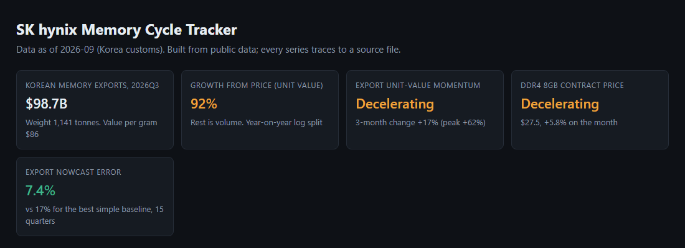
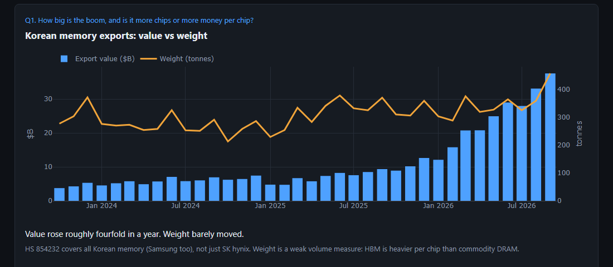
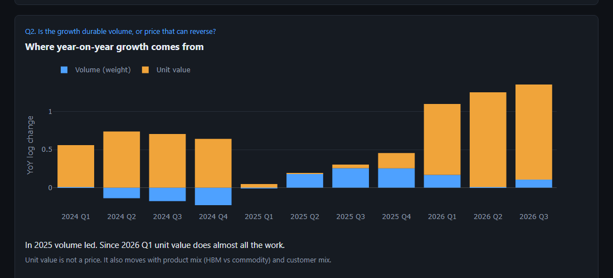
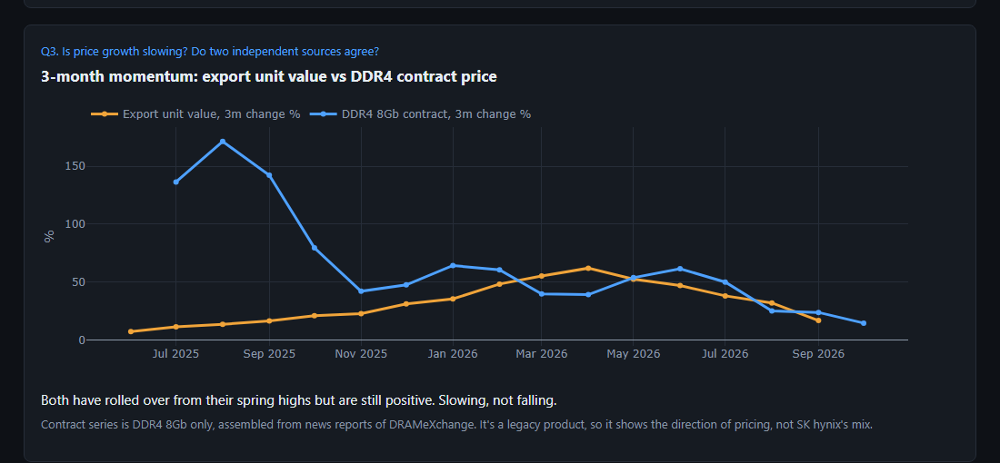
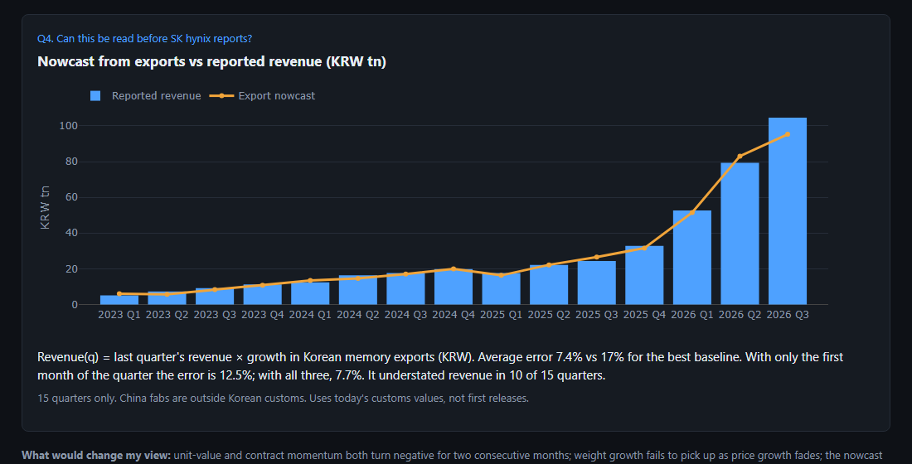

# SK hynix pitch: 3-minute script with screenshots and Q&A

Numbers below come from the files in this project (tracker: `site/index.html`, rebuild with `python -I src/site/build_site.py`).
Items marked **[VERIFY]** are things I have not checked in this project. Check them before you say them out loud.

---

## 0. Opening (30 seconds): why SK hynix

> "I like SK hynix because it sits at the center of AI hardware. Every Nvidia accelerator needs HBM, high-bandwidth memory, and hynix is the leader in it. HBM is made on the same wafers as ordinary DRAM but takes far more of them, so it tightens supply for everything. Management has said its HBM supply is largely sold out for **[VERIFY: 2027 contract status]**, and the stock trades at **[VERIFY: forward P/E, current number]** versus a history of memory stocks being cheap on peak earnings and expensive on trough earnings.
>
> The honest bear case is that memory is a commodity. Earnings are huge now, and memory cycles always turn. So the question isn't 'is demand strong', it's 'is this cycle peaking?'"

Why it works: it states the bull case in three sentences and ends on the bear case, which sets up your project as the thing that tests it.

---

## 1. The questions (15 seconds)

> "That left me with four questions I could actually test with public data:
> 1. How big is the boom, and is it more chips or just more money per chip?
> 2. Is the growth volume, which lasts, or price, which can reverse?
> 3. Is price growth slowing, and do independent sources agree?
> 4. Can I read the quarter before SK hynix reports it?
>
> The page walks through them in that order."

---

## 2. Walking the page (about 2 minutes)

### Status strip: the tiles at the top

> "Top line first. Korean memory exports were **$98.7B last quarter**. About **92% of the growth** came from value per gram rather than weight. Both price signals say *decelerating*, and the nowcast error is 7.4%. The next four sections show where each of these comes from."

The labels (Accelerating / Decelerating / Reversal watch) come from a fixed rule on momentum, not from an LLM. Say so if asked.

### Q1: value vs weight (first chart)

> "Source is Korean customs data for HS 854232, memory chips, which I cross-checked against UN Comtrade. They agree within 0.001% over 51 months. Blue bars are export value, up about four times in a year. The orange line is shipped weight, which is flat at roughly 300 to 450 tonnes a month. More money, same amount of chips."

### Q2: price vs volume (second chart)

> "I split year-on-year growth into volume and unit value using logs, so the two add up exactly. Blue is volume, orange is unit value. In 2024 it was price with falling volume. Through 2025 volume picked up. Since 2026 Q1 it is nearly all unit value. That matters because volume growth is the kind that lasts, and price growth is the kind that can reverse."

Say this unprompted: *"Unit value is not a price. It also moves with product mix, for example more HBM, which weighs more per chip. So I treat it as a price-plus-mix indicator."*

### Q3: is it slowing, do sources agree (third chart)

> "Two independent measures of pricing. Orange is export unit value from customs. Blue is the DRAM contract price for DDR4 8Gb, which I rebuilt month by month from public Korean news reports of DRAMeXchange, because the paid history is behind a login. Both peaked in spring and have rolled over, but both are still positive. So the answer is: slowing, not falling. A reversal would show up as both lines going below zero."

### Q4: the nowcast (fourth chart)

> "This is the part I'd stress. SK hynix reports roughly four weeks after quarter-end, but customs data is out the next month. My model is deliberately simple: this quarter's revenue is last quarter's revenue times export growth in won. No fitted parameters. Over 15 quarters it's off by **7.4% on average, against 17%** for the best simple baseline, and it called the direction in every quarter. Using only the first month of a quarter the error is 12.5%, so it gives a usable early read."

### Close (15 seconds)
> "Putting it together: exports show a price-driven boom, two independent price sources show it decelerating but not reversing, and the nowcast says SK hynix's reported numbers follow the export data closely. So my view is the cycle is **late but not over**, and I'd watch for unit value and contract momentum both turning negative, or volume failing to pick up as price fades. That's what would change my mind."

---

## 3. Questions you'll get, with answers

**"What did you actually solve?"**
"SK hynix reports once a quarter. I turned monthly customs data into a revenue estimate available weeks earlier, and into a price-versus-volume read on whether the boom is durable."

**"Exports are public. Doesn't the market already watch this?"**
"Headline semiconductor exports, yes. What I added is memory-specific, split into price and volume, and tested against SK hynix revenue. I'm not claiming a trading edge, I'm claiming a faster, more specific read. Whether the market has already priced it in is a separate question this doesn't answer."

**"HS 854232 includes Samsung. How is it SK hynix?"**
"It isn't, it's the Korean memory industry. SK hynix is roughly three-quarters of the nowcast base **[VERIFY: share recently ~0.77, from the nowcast file]**. The model understated SK hynix revenue in 10 of 15 quarters, so SK hynix has grown a bit faster than the industry, consistent with HBM share gains **[interpretation, not tested]**. SK hynix's China fabs ship from China, so they're outside the data."

**"Is unit value a price?"**
"No. It mixes price, product mix and customer mix. That's why I use DRAM contract prices as an independent check. They agree on direction: both slowing."

**"The contract series is DDR4 8Gb, a legacy product."**
"Correct, and it's the only monthly contract series I could rebuild for free. It shows the direction of pricing, not the level hynix gets on HBM. I'd want DDR5 and HBM prices, which are paid data."

**"Fifteen data points is tiny. Why trust 7.4%?"**
"I don't claim statistical significance. I claim it beat simple baselines in a sample that includes a downturn (2023) and an upturn. The rule has no fitted parameters, so there's little to overfit. I'd want more quarters, which means older financials."

**"Did you use data that wasn't available at the time?"**
"One leak: customs values are today's, possibly revised, not first releases. Everything else is lagged correctly. Revisions are small but I'd confirm that with first-release data."

**"What was the biggest mistake you caught?"**
Two good ones, both true: (1) I first downloaded Korea-to-US exports only and caught it by matching against Comtrade's US-partner data. (2) My first nowcast looked broken (25% error) until I found a currency-conversion timing bug, where Yahoo's month-start dates shifted FX by one month. After the fix the error fell to 7.4%. Say it plainly: "I distrusted a bad result and checked the plumbing before changing the model."

**"Your model says Q3 was ₩94tn. Actual was ₩104.6tn."**
"Yes, 9% low. It missed the upside surprise because SK hynix's share of Korean exports kept rising. I'd rather show you the miss than hide it."

**"So is the stock a buy?"**
"The data says the earnings boom is price-driven and decelerating, not reversing. At **[VERIFY: valuation]** the market is already pricing a lot of it. My view is 'cycle late, not over', so I'd size accordingly and watch the two exit signals. I'm not claiming the data alone justifies a valuation call."

**"Why Claude / an LLM in this?"**
Be accurate: right now the LLM piece is **not built**. The planned use is extracting contract-price rows from Korean news with a human approval step. If asked, say that; don't imply it's in the page.

---

## 4. Weak spots to fix or avoid claiming

1. **"approved" column.** All 24 rows in `data/raw/dram_prices/dram_contract_monthly.csv` say "yes (user 2026-11-08)". I haven't seen you review them. Spot-check 5 to 6 rows against their source links before saying "verified".
2. **Missing months.** The contract series has no Dec 2024 row, and only one DDR5 data point. The page shows gaps as gaps.
3. **Dependence on collected prices.** The Q3 chart rests on one product line from news reports.
4. **Nowcast chart is in levels.** The huge 2026 numbers make the error look smaller than it is. A log scale or an error-percent chart would be fairer.
5. **Shaky context claims.** Nvidia/HBM leadership, 2027 contracts, multiple: I haven't verified them. Get current numbers.
6. **No live Q4 call yet.** The strongest interview line would be "my model says Q4 revenue will be ₩X, before it's reported". That needs October and November 1–10 customs data.
7. **Consensus.** The ~₩98tn consensus I saw for Q3 came from a secondary news source. Don't quote it as fact without checking.
